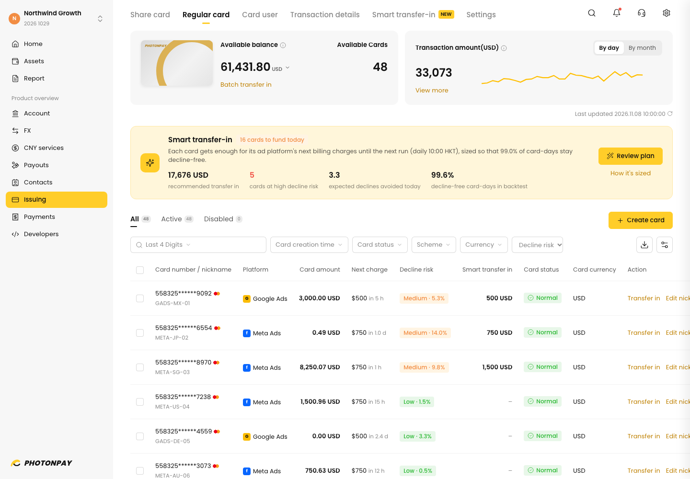

# Smart transfer-in for PhotonPay Regular Cards

**Live demo:** https://mohith26.github.io/photonpay-smart-transfer-in/

PhotonPay Regular Cards are prepaid: someone has to "Transfer in" before Meta or Google bills the card, and the minimum is 20 USD per card (PhotonPay Help Center, Issuing Management). Agencies running dozens of ad cards either park far too much money on every card or get declines, and a declined ad charge pauses delivery until the card is funded. Smart transfer-in plans each run's batch transfer in: a billing-aware forecast replays each platform's public billing rules on the card's recent spend, and adaptive conformal calibration sizes the buffer so a chosen share of card-days stays decline-free. On a 48-card synthetic agency fleet over 91 days it kept **99.60% of card-days decline-free (target 99%)** with **52% less money parked on cards** than topping up to last week's charges at the same decline rate, and 74% less than a flat per-card buffer.



## How it works

1. **Billing rules (public).** Meta charges when unbilled costs reach the payment threshold, raises the threshold after successful payments, and charges leftovers on the monthly bill date; daily spend can reach 175% of the daily budget and 7x per week (Meta Business Help Centre). Google Ads charges at the threshold or 30 days after the last charge (50, 200, 350, 500 USD), with daily spend up to 2x budget. `src/sim.js` implements both.
2. **Billing-aware forecast.** For each card, a 3-day half-life EWMA of observed spend is replayed hour by hour through that card's billing state (unbilled amount, threshold step, bill date) until the next run. That gives the charges the card must absorb, which are lumpy: often zero, then 750 USD at once.
3. **Calibration on spend, not charges.** The score for each finished card-window is realized spend divided by forecast spend (smoothed by 20 USD), pooled per platform over the last 400 windows. The target balance is the forecast charges at spend scaled by the conformal quantile `ceil((n+1)(1-a))`. Charges are a non-decreasing function of spend for a given billing state, so covering the spend with probability `1-a` covers the charges with at least that probability. A declined window is censored (the true need is unknown), so it is scored as a miss.
4. **Adaptive level.** Ad budgets change, so the miss level follows adaptive conformal inference (Gibbs and Candès 2021): `a_t+1 = a_t + gamma (a - misses_t)`, which keeps the long-run decline rate at or under target without assuming exchangeable weeks.
5. **When the funding account is short.** "Fit to balance" solves the allocation exactly as a multiple-choice knapsack over 20 USD units (dynamic programming): minimise the sum over cards of spend rate x decline probability, where each card's decline probability comes from its calibrated risk curve.
6. **Backtest.** 48 synthetic ad accounts (60% Meta), lognormal budgets, campaign scale-ups, cuts and pauses, day-of-week and hourly patterns. The first 28 days are a warm-up shared by every policy; everything after is scored. Declines pause spend until the next run, which is when the failed charge is retried.

## Results (`node scripts/build-results.mjs`, daily 10:00 run, target 99% decline-free)

| Policy | Decline-free card-days | Declines | Ad downtime | Avg money on cards |
|---|---:|---:|---:|---:|
| **Smart transfer-in** | **99.60%** | 13 | 71 h | **$132,397** |
| Top up to 1.5x last 7 days' charges | 99.97% | 1 | 23 h | $436,756 |
| Top up to 1x last 7 days' charges | 99.90% | 3 | 57 h | $301,329 |
| Flat buffer $4,000 per card | 96.77% | 98 | 857 h | $215,402 |
| Billing-aware forecast, no buffer | 84.48% | 470 | 3,109 h | $90,562 |

At Smart transfer-in's realized decline rate (0.40% of card-days), the last-week rule needs $276,332 on cards and a flat buffer $516,467 (interpolated along each policy's sweep, never extrapolated). The frontier chart in the app shows every setting.

Honest caveat on the run schedule: with only two runs a week (Mon + Thu) there are ~4x fewer windows to calibrate on and calibration turns conservative. At a 99% target it lands at 99.88% decline-free but parks about 9% more than the last-week rule at the same rate; at a 95% target it parks less. Daily runs are where this shines, and daily is cheap once transfers go through the `recharge` API.

## The app

A static page in the PhotonPay portal shell (tokens from the production CSS on portal.photonpay.com: `--ptp-brand-n-default-color #ffcd29`, `--ptp-text-brand-color #bf8000`, `--ptp-bg-sec-default-color #f7f7f7`, `#121212` text, success/warning/danger pairs; layout from the Help Center's Issuing screenshots). Regular card list with decline risk and next charge per card; a Smart transfer-in strip with today's plan; the real **Batch transfer in** flow pre-filled by the plan (editable amounts, risk updates live, fee confirmation, fit-to-balance, submit); card drawer with 91 days of balance, charges, transfers and declines; a Smart transfer-in tab with the policy frontier and settings that re-run the backtest in a Web Worker. Deep links, localStorage, CSV/JSON export, keyboard shortcuts (`?`).

## Run

```bash
python3 -m http.server 8000      # open http://localhost:8000
node --test test/*.test.mjs      # 14 tests: billing rules, conformal rank + randomized coverage, DP vs brute force, money conservation, decline/retry, calibration, headline reproduction
node scripts/build-results.mjs   # regenerates data/results.json
```

## Limitations

- **Synthetic accounts.** Budgets, events and spend noise are generated; only the billing rules and PhotonPay's 20 USD minimum are real. Meta's threshold ladder after 25 USD varies by account; the one used (25, 50, 250, 500, 750) is commonly reported, not official.
- **PhotonPay sees charges, not budgets.** The forecast uses only card-side history. If an agency could share planned budget changes, forecasts and buffers would shrink.
- **Handling fees ignored.** Transfer-in fees depend on the merchant's pricing; fewer, larger transfers would matter if fees are per transfer.
- **Guarantee scope.** Conformal coverage is marginal over card-windows (pooled per platform), not per card; adaptive calibration controls the long-run rate. Censoring declined windows as misses makes it conservative.

## Prior art and what is new

Threshold auto top-up rules (top up to X when the balance falls below Y) are common in prepaid products, and quantile-sized cash buffers are standard in treasury. Adaptive conformal inference is from Gibbs and Candès (2021). What I did not find in PhotonPay's API (`/vcc/openApi/v4/recharge` is a manual call; changelog checked through 2026-10-29), Help Center or product pages is a transfer-in planner that replays each ad platform's billing rules per card and calibrates the buffer with a stated decline-rate guarantee, plus an exact allocation when funds are short.

---

Unofficial concept demo by Mohith Gajjela. Not affiliated with PhotonPay. Synthetic data.
